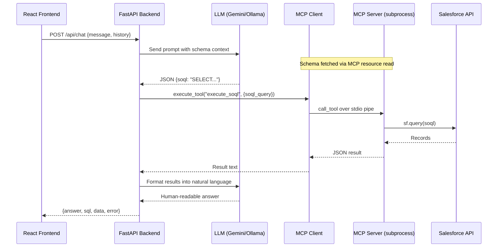
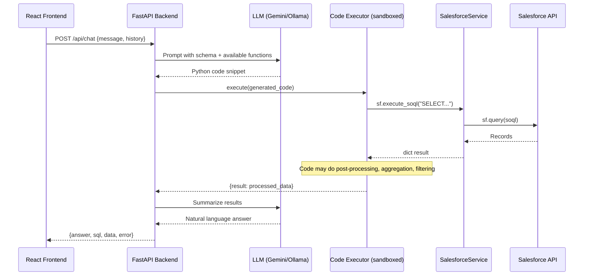
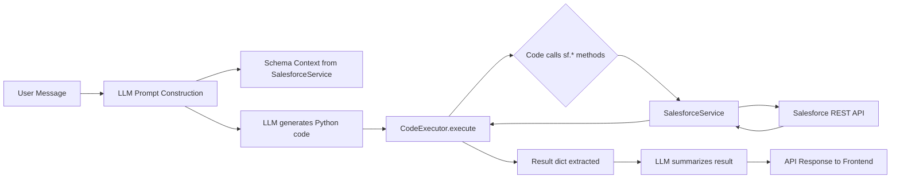

# MCP → DCE Migration Analysis: Salesforce Chat Assistant

> **Status:** Analysis Only — No code changes made  
> **Project:** Salesforce MCP Chat Assistant  
> **Date:** July 17, 2026

---

## Table of Contents

1. [Current MCP Architecture Analysis](#1-current-mcp-architecture-analysis)
2. [What is DCE (Dynamic Code Execution)?](#2-what-is-dce-dynamic-code-execution)
3. [How DCE Would Work in This Project](#3-how-dce-would-work-in-this-project)
4. [Detailed Architecture](#4-detailed-architecture)
5. [Capabilities](#5-capabilities)
6. [Advantages and Disadvantages](#6-advantages-and-disadvantages)
7. [Migration Strategy](#7-migration-strategy)
8. [Recommendations](#8-recommendations)

---

## 1. Current MCP Architecture Analysis

### Overview

Your project is a **Salesforce Chat Assistant** with a React frontend and FastAPI backend. It uses the **Model Context Protocol (MCP)** to bridge an LLM (Gemini or Ollama) with Salesforce data operations.

### Current File Map

| File | Role |
|------|------|
| [main.py](file:///d:/DCE%20-%20Salesforce/backend/app/main.py) | FastAPI entry point; manages MCP lifecycle |
| [mcp_client.py](file:///d:/DCE%20-%20Salesforce/backend/app/mcp_client.py) | Stdio-based MCP client; connects to MCP subprocess |
| [llm_service.py](file:///d:/DCE%20-%20Salesforce/backend/app/llm_service.py) | LLM orchestration; prompt engineering, tool-call routing |
| [salesforce_server.py](file:///d:/DCE%20-%20Salesforce/backend/mcp_server/salesforce_server.py) | FastMCP server; exposes Salesforce tools & resources |
| [mysql_server.py](file:///d:/DCE%20-%20Salesforce/backend/mcp_server/mysql_server.py) | FastMCP server for MySQL (secondary, unused in main flow) |
| [config.py](file:///d:/DCE%20-%20Salesforce/backend/app/config.py) | Pydantic settings loader |
| [App.jsx](file:///d:/DCE%20-%20Salesforce/frontend/src/App.jsx) | React chat UI |
| [MessageBubble.jsx](file:///d:/DCE%20-%20Salesforce/frontend/src/components/MessageBubble.jsx) | Message display with tabs |
| [DataTable.jsx](file:///d:/DCE%20-%20Salesforce/frontend/src/components/DataTable.jsx) | Dynamic table renderer |
| [DataChart.jsx](file:///d:/DCE%20-%20Salesforce/frontend/src/components/DataChart.jsx) | Auto-visualized bar charts |
| [SchemaExplorer.jsx](file:///d:/DCE%20-%20Salesforce/frontend/src/components/SchemaExplorer.jsx) | Salesforce schema browser |

### Current Request Flow (MCP)



### MCP-Specific Components in Your Project

| Component | What It Does | MCP Dependency |
|-----------|-------------|----------------|
| `MCPSalesforceClient` | Launches `salesforce_server.py` as a **subprocess**, communicates over **stdio** | **Heavy** — uses `mcp.ClientSession`, `StdioServerParameters`, `stdio_client` |
| `salesforce_server.py` | Runs as a **separate process**, registers tools via `@mcp.tool()` decorators | **Heavy** — built entirely on `FastMCP` |
| `llm_service.py` | Calls `sf_mcp_client.execute_tool()` and `sf_mcp_client.read_resource()` | **Medium** — depends on MCP client API |
| `main.py` | Starts/stops MCP client in lifespan hooks | **Light** — lifecycle management only |
| Frontend | No MCP awareness whatsoever | **None** |

---

## 2. What is DCE (Dynamic Code Execution)?

### Definition

**DCE (Dynamic Code Execution)** is an architectural pattern where — instead of routing LLM outputs through a fixed set of pre-registered tools via a protocol — the LLM generates **executable code** (Python, SOQL, SQL, etc.) that is run **directly** within the backend process.

### Core Concepts

| Concept | Description |
|---------|-------------|
| **Code Generation** | The LLM produces runnable code snippets instead of structured tool-call requests |
| **In-Process Execution** | Generated code runs within the same Python process — no subprocess, no IPC |
| **Sandbox / Guardrails** | A controlled execution environment (`exec()`, `RestrictedPython`, Docker, etc.) limits what generated code can do |
| **Dynamic Capability** | The LLM isn't limited to a fixed list of tools — it can compose arbitrary logic, loops, conditionals, aggregations |

### How DCE Differs from MCP

| Dimension | MCP (Current) | DCE (Proposed) |
|-----------|--------------|----------------|
| **Interaction Model** | LLM requests a tool by name + arguments → protocol routes it | LLM generates code → code is executed directly |
| **Communication** | Stdio pipe between client/server processes (JSON-RPC) | In-process function calls; no IPC needed |
| **Process Model** | Separate subprocess for each MCP server | Single process; everything runs in-line |
| **Tool Discovery** | LLM reads a fixed tool manifest (`list_tools()`) | LLM is given available functions/classes as context |
| **Flexibility** | Limited to pre-defined tool signatures | Unlimited — LLM can compose any logic within sandbox |
| **Latency** | Higher: subprocess startup + stdio serialization + JSON-RPC overhead | Lower: direct function call, no serialization |
| **Security Model** | Tool-level access control; server enforces safety | Code-level sandboxing; must restrict what `exec()` can access |
| **Error Handling** | Structured error responses from MCP protocol | Python exceptions caught from `exec()` / `eval()` |
| **Standardization** | Open protocol (MCP spec); interoperable with any MCP host | Custom implementation; not standardized |

### Typical Use Cases for DCE

- **Data analysis pipelines** — LLM writes Pandas/SQL code to analyze data on the fly
- **Salesforce/CRM automation** — LLM generates SOQL + post-processing logic in one pass
- **Code interpreter chatbots** — like ChatGPT's Code Interpreter
- **Report generation** — LLM produces code that queries, aggregates, and formats reports
- **Rapid prototyping** — when the overhead of defining MCP tools for every operation is too high

---

## 3. How DCE Would Work in This Project

### What Changes

| Component | Current (MCP) | Proposed (DCE) | Change Level |
|-----------|--------------|----------------|--------------|
| `mcp_client.py` | MCP stdio client managing subprocess | **REMOVED** entirely | 🔴 Deleted |
| `mcp_server/salesforce_server.py` | FastMCP server process with `@mcp.tool()` | **REMOVED** — tools become plain Python functions | 🔴 Deleted |
| `mcp_server/mysql_server.py` | FastMCP MySQL server | **REMOVED** — functions become direct callables | 🔴 Deleted |
| `mcp_server/` directory | MCP server scripts | **Replaced** by `services/salesforce_service.py` | 🟡 Restructured |
| `llm_service.py` | Calls `sf_mcp_client.execute_tool()` | Calls `exec()` on LLM-generated Python code | 🔴 Major rewrite |
| `main.py` | MCP lifespan management | Salesforce session lifespan (simpler) | 🟡 Simplified |
| `config.py` | Same | **No change** | 🟢 Unchanged |
| `requirements.txt` | Includes `fastmcp`, `mcp` | Remove MCP deps; add sandbox deps if needed | 🟡 Modified |
| Frontend (all) | No MCP awareness | **No change** | 🟢 Unchanged |

### New Component: `salesforce_service.py`

The MCP server's tools become **plain Python functions** importable directly:

```python
# services/salesforce_service.py (DCE version)
from simple_salesforce import Salesforce

class SalesforceService:
    """Direct Salesforce operations — no MCP layer."""
    
    def __init__(self, sf: Salesforce):
        self.sf = sf
    
    def execute_soql(self, soql_query: str) -> dict:
        """Same logic as the MCP tool, but returns dict directly."""
        ...
    
    def describe_object(self, object_name: str) -> str:
        ...
    
    def list_objects(self) -> str:
        ...
    
    def search_records(self, sosl_query: str) -> dict:
        ...
    
    def get_schema_overview(self) -> str:
        ...
```

### New Component: `code_executor.py`

A sandboxed execution engine that runs LLM-generated Python:

```python
# services/code_executor.py
class CodeExecutor:
    """Sandboxed execution of LLM-generated Python code."""
    
    def __init__(self, sf_service: SalesforceService):
        self.sf = sf_service
        # Only expose safe functions to generated code
        self.allowed_globals = {
            "sf": self.sf,
            "json": json,
            "print": print,
            # NO os, sys, subprocess, open, eval, etc.
        }
    
    def execute(self, code: str) -> dict:
        """Run code in a restricted namespace, return results."""
        local_ns = {}
        exec(code, self.allowed_globals, local_ns)
        return local_ns.get("result", {})
```

### Overall Execution Flow (DCE)



> [!IMPORTANT]
> Key difference: The LLM can now generate **multi-step logic** in a single code block — e.g., query Salesforce, filter results, compute aggregations, format output — all in one execution pass, instead of multiple MCP tool round-trips.

---

## 4. Detailed Architecture

### High-Level Architecture Diagram

```
┌──────────────────────────────────────────────────────────────────────┐
│                         REACT FRONTEND                               │
│  ┌──────────┐  ┌──────────────┐  ┌──────────┐  ┌────────────────┐  │
│  │ App.jsx  │  │MessageBubble │  │DataTable │  │   DataChart    │  │
│  └────┬─────┘  └──────────────┘  └──────────┘  └────────────────┘  │
│       │  HTTP POST /api/chat                                        │
├───────┼─────────────────────────────────────────────────────────────-┤
│       ▼                                                              │
│  ┌─────────────────────────────────────────────────────────────┐    │
│  │                    FASTAPI BACKEND (Single Process)          │    │
│  │                                                              │    │
│  │  ┌──────────┐    ┌───────────────┐    ┌──────────────────┐  │    │
│  │  │ main.py  │───▶│ llm_service   │───▶│  code_executor   │  │    │
│  │  │ (routes) │    │ (orchestrator)│    │  (sandboxed env)  │  │    │
│  │  └──────────┘    └───────┬───────┘    └────────┬─────────┘  │    │
│  │                          │                     │              │    │
│  │                          ▼                     ▼              │    │
│  │              ┌───────────────────┐  ┌────────────────────┐  │    │
│  │              │   LLM Provider    │  │ salesforce_service  │  │    │
│  │              │ (Gemini / Ollama) │  │ (direct API calls)  │  │    │
│  │              └───────────────────┘  └─────────┬──────────┘  │    │
│  │                                               │              │    │
│  │  ┌──────────┐                                 │              │    │
│  │  │config.py │  (.env credentials)             │              │    │
│  │  └──────────┘                                 │              │    │
│  └───────────────────────────────────────────────┼──────────────┘    │
│                                                   │                  │
│                                                   ▼                  │
│                                      ┌────────────────────┐         │
│                                      │   Salesforce API    │         │
│                                      │  (SOQL/SOSL/REST)   │         │
│                                      └────────────────────┘         │
└─────────────────────────────────────────────────────────────────────┘
```

### Component-by-Component Explanation

#### 1. `main.py` — FastAPI Entry Point (Simplified)

```diff
- # MCP version: starts subprocess, manages stdio connection
- await sf_mcp_client.start()
- await sf_mcp_client.stop()

+ # DCE version: creates Salesforce session directly
+ sf = Salesforce(username=..., password=..., security_token=...)
+ sf_service = SalesforceService(sf)
+ code_executor = CodeExecutor(sf_service)
```

No subprocess management. No stdio pipes. Just a direct `simple_salesforce` connection.

#### 2. `llm_service.py` — LLM Orchestrator (Rewritten)

**Before (MCP):** LLM outputs JSON `{"soql": "SELECT..."}` → manually parsed → routed to `sf_mcp_client.execute_tool()`

**After (DCE):** LLM outputs Python code → executed via `code_executor.execute()` → result extracted

The LLM prompt changes from:
```
"Output a JSON object: {\"soql\": \"SELECT ...\"}"
```
To:
```
"Write Python code that uses the `sf` object to query Salesforce.
Available functions: sf.execute_soql(query), sf.describe_object(name), ...
Store your final result in a variable called `result`."
```

#### 3. `salesforce_service.py` — Direct Salesforce Access (New)

Same logic as current `salesforce_server.py`, but:
- No `@mcp.tool()` decorators
- No `FastMCP` dependency
- Returns Python objects directly (not serialized strings)
- Runs in-process, not as a subprocess

#### 4. `code_executor.py` — Sandboxed Execution Engine (New)

Safely executes LLM-generated Python by:
- Providing a **whitelist** of allowed objects (`sf`, `json`, basic builtins)
- **Blocking** dangerous modules (`os`, `sys`, `subprocess`, `open`, `__import__`)
- Wrapping execution in `try/except` for graceful error handling
- Setting **timeout** limits on execution
- Optionally using `RestrictedPython` for AST-level enforcement

### Request Lifecycle

```
1. User types "show me all WIP tasks for Ijaz"
2. Frontend → POST /api/chat
3. Backend fetches Salesforce schema (direct call to sf_service.get_schema_overview())
4. Backend constructs prompt with schema + user question + available functions
5. LLM generates Python code:
   ┌──────────────────────────────────────────────────────────┐
   │ data = sf.execute_soql(                                  │
   │     "SELECT Name, Task_Status__c, Task_Resource__r.Name" │
   │     " FROM Task_Allocation__c"                           │
   │     " WHERE Task_Status__c = 'WIP'"                      │
   │     " AND Task_Resource__r.Name LIKE '%Ijaz%'"           │
   │     " LIMIT 200"                                         │
   │ )                                                        │
   │ result = {                                               │
   │     "soql": "SELECT ...",                                │
   │     "records": data.get("records", []),                  │
   │     "total": data.get("totalSize", 0)                    │
   │ }                                                        │
   └──────────────────────────────────────────────────────────┘
6. CodeExecutor runs this in sandboxed namespace
7. sf_service.execute_soql() → Salesforce API → records returned
8. Result captured from local namespace
9. LLM summarizes the data into natural language
10. Response sent to frontend: {answer, sql, data, error}
```

### Data Flow



### Security Model

> [!CAUTION]
> DCE introduces code execution risks that MCP does not have. The following safeguards are **mandatory**.

| Layer | Protection | Implementation |
|-------|-----------|----------------|
| **SOQL Safety** | Read-only enforcement | Same `is_soql_safe()` check — **retained from MCP version** |
| **Namespace Restriction** | Whitelist allowed globals | Only `sf`, `json`, `math` exposed; no `os`, `sys`, `open`, `__import__` |
| **AST Validation** | Pre-scan generated code | Use `ast.parse()` to reject `import`, `exec`, `eval`, `open` calls |
| **Timeout** | Prevent infinite loops | `signal.alarm()` or `threading.Timer` with 30s max |
| **Input Sanitization** | Object name validation | Same regex validation as current MCP server |
| **Output Size Limit** | Prevent memory exhaustion | Cap result to 200 records / 1MB payload |
| **No File I/O** | Block filesystem access | Not exposed in sandbox namespace |
| **No Network** | Block arbitrary HTTP | Only `sf_service` methods available; no `requests`, `urllib`, `httpx` |

### Error Handling

| Error Type | MCP (Current) | DCE (Proposed) |
|------------|--------------|----------------|
| Salesforce auth failure | MCP server returns error string | `SalesforceService` raises exception, caught by executor |
| Invalid SOQL | MCP tool returns error string | `execute_soql()` returns error dict; executor captures it |
| LLM produces bad JSON | JSON parse fails → generic error | LLM produces bad Python → `SyntaxError` caught by executor |
| Timeout | MCP subprocess might hang | `CodeExecutor` enforces timeout → `TimeoutError` |
| Sandbox violation | N/A (tools are fixed) | AST validator rejects code → clear error message |
| Network failure | MCP client connection error | `httpx` / `simple_salesforce` timeout → retryable error |

### Code Execution Lifecycle

```
┌─────────────────┐
│ LLM Output      │ Raw Python code string
└────────┬────────┘
         ▼
┌─────────────────┐
│ AST Validation  │ Parse with ast.parse(), check for banned constructs
└────────┬────────┘
         ▼
┌─────────────────┐
│ Namespace Setup │ Build {sf, json, math, ...} whitelist globals
└────────┬────────┘
         ▼
┌─────────────────┐
│ exec() in       │ Execute with timeout; capture `result` variable
│ sandboxed ns    │
└────────┬────────┘
         ▼
┌─────────────────┐
│ Result Extract  │ Pull `result` from local namespace; serialize
└────────┬────────┘
         ▼
┌─────────────────┐
│ Error Handling  │ Any exception → wrapped as {error: str}
└─────────────────┘
```

---

## 5. Capabilities

### What DCE Enables That MCP Does Not

| Capability | MCP | DCE |
|-----------|-----|-----|
| **Multi-step queries** | Requires multiple round-trips (describe → generate SOQL → execute) | Single code block: query, process, format |
| **In-code aggregation** | LLM must generate SOQL aggregations (limited) | Python can do arbitrary `sum()`, `groupby()`, filtering |
| **Conditional logic** | Not possible — each tool call is independent | LLM writes `if/else` to handle different data shapes |
| **Cross-query joins** | Requires multiple SOQL queries + manual client-side joins | Python code can run 2 queries and merge results in one pass |
| **Data transformation** | Frontend handles display; backend returns raw | Code can pivot, reshape, compute derived fields |
| **Custom formatting** | Hard-coded in prompt | LLM generates formatting code dynamically |
| **Error recovery** | Manual re-prompt on failure | Code can include `try/except` with fallback queries |

### What Tasks Become Easier

- **"Show me the task completion rate per resource"** → LLM generates code that queries + computes percentages
- **"Compare this month vs last month tasks"** → Two SOQL queries + comparison logic in one block
- **"Find tasks that are overdue"** → Code with datetime comparison, no need for complex SOQL date functions
- **Complex aggregations** that SOQL can't express natively

### How DCE Improves This Project

1. **Eliminates subprocess overhead** — No more spawning `salesforce_server.py` as a child process
2. **Removes IPC latency** — No stdio pipe serialization/deserialization
3. **Simplifies deployment** — One process, fewer moving parts
4. **Enables richer responses** — LLM can compute derived insights, not just query raw data
5. **Reduces prompt complexity** — No need for complex JSON-output-format instructions

---

## 6. Advantages and Disadvantages

### Comparison Matrix

| Dimension | MCP (Current) | DCE (Proposed) | Verdict |
|-----------|--------------|----------------|---------|
| **Performance** | Higher latency (subprocess + stdio + JSON-RPC) | Lower latency (in-process function calls) | ✅ DCE wins |
| **Scalability** | Each request uses subprocess resources | Lighter per-request footprint | ✅ DCE wins |
| **Maintainability** | Two codebases (client + server) to maintain | Single unified codebase | ✅ DCE wins |
| **Security** | Inherently safer (fixed tool set, process isolation) | Requires careful sandboxing of `exec()` | ⚠️ MCP safer by default |
| **Development Complexity** | More boilerplate (MCP protocol, decorators) | Simpler functions, but sandbox code is complex | 🔄 Trade-off |
| **Operational Costs** | Two processes to monitor/log | Single process | ✅ DCE wins |
| **Debugging** | Harder (cross-process, stdio trace) | Easier (single process, standard Python debugger) | ✅ DCE wins |
| **Interoperability** | MCP is an open protocol; works with any MCP host | Custom; only works with your backend | ⚠️ MCP wins |
| **Flexibility** | Limited to registered tools | Unlimited (any code the LLM can write) | ✅ DCE wins |
| **LLM Dependency** | LLM generates structured data (JSON) | LLM generates code (harder, more error-prone) | ⚠️ MCP more reliable |
| **Error Surface** | Predictable (tool not found, bad args) | Unpredictable (syntax errors, runtime errors, infinite loops) | ⚠️ MCP more predictable |

### Detailed Analysis

#### ✅ DCE Advantages

1. **~3-5x lower latency per tool call** — No subprocess startup, no stdio serialization
2. **Simpler deployment** — No need to manage child processes; single `uvicorn` command
3. **Richer LLM capabilities** — LLM can compose logic, not just call predefined functions
4. **Easier testing** — Unit test functions directly; no MCP protocol mocking needed
5. **Fewer dependencies** — Remove `fastmcp` and `mcp` packages entirely

#### ⚠️ DCE Disadvantages

1. **Security risk from `exec()`** — Must implement robust sandboxing (AST validation, namespace restriction, timeouts)
2. **LLM code quality** — LLMs sometimes generate syntactically invalid Python; more error handling needed
3. **No protocol standard** — MCP is a standardized protocol; DCE is a custom pattern
4. **Loss of process isolation** — A crash in generated code affects the whole backend process
5. **Harder to extend** — Adding a new data source means modifying the executor, not just adding a new MCP server

---

## 7. Migration Strategy

### Step-by-Step Plan

> [!NOTE]
> Each phase is designed to be independently testable and reversible.

#### Phase 1: Extract Salesforce Logic (Low Risk)

**Goal:** Extract the Salesforce operations from MCP server into standalone functions.

```
1.1  Create `backend/app/services/` directory
1.2  Create `salesforce_service.py` — copy logic from salesforce_server.py as plain methods
1.3  Create `__init__.py` for the services module
1.4  Write unit tests for SalesforceService (test_salesforce_service.py)
1.5  Verify all 4 tools work: execute_soql, describe_object, list_objects, search_records
1.6  Verify schema resource: get_schema_overview
```

**Risk:** Low — no existing code is modified yet.

#### Phase 2: Build Code Executor (Medium Risk)

**Goal:** Create the sandboxed execution engine.

```
2.1  Create `code_executor.py` in services/
2.2  Implement namespace whitelist (sf, json, math)
2.3  Implement AST validator (ban imports, exec, eval, open)
2.4  Implement timeout mechanism
2.5  Write comprehensive tests (valid code, invalid code, timeout, sandbox escape attempts)
```

**Risk:** Medium — sandbox correctness is critical for security.

#### Phase 3: Rewrite LLM Service (High Risk)

**Goal:** Change the LLM prompt strategy from JSON-output to code-generation.

```
3.1  Create new prompt templates for code generation
3.2  Modify _process_gemini() to send code-gen prompts and execute results
3.3  Modify _process_ollama() similarly
3.4  Add fallback: if code execution fails, retry with JSON-output prompt
3.5  Update error handling for code-execution errors
3.6  Test with all existing suggested queries
```

**Risk:** High — this is the core behavior change. Must test thoroughly.

#### Phase 4: Simplify main.py (Low Risk)

**Goal:** Remove MCP lifecycle management.

```
4.1  Replace MCP client start/stop with direct Salesforce session
4.2  Update lifespan hooks
4.3  Update root endpoint to show "DCE" instead of "MCP"
4.4  Remove mcp_client.py
4.5  Remove mcp_server/ directory
```

**Risk:** Low — straightforward removal.

#### Phase 5: Clean Up (Low Risk)

```
5.1  Update requirements.txt — remove fastmcp, mcp
5.2  Update README.md with new architecture description
5.3  Update frontend loading text ("via MCP" → "via DCE")
5.4  Update .env.example if any config changes
5.5  Final integration testing
```

### Proposed New File Structure

```
backend/
├── app/
│   ├── __init__.py
│   ├── config.py                    # ✅ Unchanged
│   ├── main.py                      # 🟡 Simplified (no MCP lifecycle)
│   ├── llm_service.py               # 🔴 Major rewrite (code-gen prompts)
│   └── services/
│       ├── __init__.py              # 🆕 New
│       ├── salesforce_service.py    # 🆕 New (extracted from MCP server)
│       └── code_executor.py         # 🆕 New (sandboxed execution)
├── tests/
│   ├── test_salesforce_service.py   # 🆕 New
│   └── test_code_executor.py        # 🆕 New
├── .env
├── .env.example
└── requirements.txt                 # 🟡 Modified (remove MCP deps)
```

### Risks

| Risk | Severity | Mitigation |
|------|----------|------------|
| Sandbox escape | 🔴 Critical | AST validation + namespace restriction + no `__import__` + no `eval` |
| LLM generates bad code | 🟡 Medium | Fallback to JSON-mode prompt; retry logic |
| Infinite loops in generated code | 🟡 Medium | Timeout enforcement (30s max) |
| Breaking existing queries | 🟡 Medium | Test all 4 suggested queries before deploying |
| Salesforce session management | 🟢 Low | Re-use same `simple_salesforce` session; handle token refresh |

### Compatibility Concerns

- **Frontend:** Zero changes required — the API contract (`{answer, sql, data, error}`) remains identical
- **Salesforce API:** No changes — same `simple_salesforce` library used
- **LLM APIs:** Same providers (Gemini/Ollama), but prompts change significantly
- **.env config:** Same variables; no new credentials needed
- **Python version:** No change (3.10+)

---

## 8. Recommendations

### Should You Replace MCP with DCE?

> [!IMPORTANT]
> **Yes, for this specific project, DCE is the better architectural choice.** Here's why:

#### Why DCE is Better Here

1. **This is a single-data-source project** — You only query Salesforce. MCP's multi-server interoperability adds no value.

2. **The MCP layer is pure overhead** — The subprocess + stdio pipe adds latency and complexity for zero benefit. Your MCP server only talks to one backend.

3. **Your LLM workflow is already custom** — You're manually parsing JSON responses and routing to tools. MCP's tool-calling protocol isn't being used to its full potential (no native function-calling API integration).

4. **You want richer query capabilities** — DCE enables multi-step logic, computed aggregations, and cross-query analysis that your current architecture cannot do.

5. **Deployment simplicity** — One process is easier to deploy, monitor, and debug than a client + subprocess architecture.

#### When to Keep MCP Instead

- If you need to **connect multiple independent data sources** (Salesforce + MySQL + external APIs) through a unified protocol
- If you want to **share your Salesforce MCP server** with other MCP-compatible applications (Claude Desktop, VS Code, etc.)
- If **security is paramount** and you need process-level isolation between the LLM and the data layer
- If your team is **not comfortable** implementing and maintaining a code execution sandbox

#### Hybrid Architecture (Recommended)

> [!TIP]
> The best approach for this project is a **DCE-primary with JSON-fallback** hybrid:

```
┌─────────────────────────────────────────────┐
│           LLM generates response            │
│                                             │
│  ┌─────────────┐     ┌──────────────────┐  │
│  │ Primary:    │     │ Fallback:        │  │
│  │ Python Code │────▶│ JSON + Direct    │  │
│  │ Generation  │fail │ Function Call    │  │
│  └─────────────┘     └──────────────────┘  │
└─────────────────────────────────────────────┘
```

**How it works:**
1. **Primary path:** LLM generates Python code → sandboxed execution → rich results
2. **Fallback path:** If code generation/execution fails, fall back to the current JSON-output approach (LLM outputs `{"soql": "..."}` → direct function call)
3. **Benefit:** You get DCE's power when the LLM succeeds, with reliable fallback when it doesn't

This gives you the **best of both worlds** while eliminating the MCP subprocess overhead entirely.

### Final Verdict

| Approach | Recommendation |
|----------|---------------|
| Full MCP retention | ❌ Not recommended — excessive overhead for a single-data-source project |
| Full DCE replacement | ✅ Good — major simplification with richer capabilities |
| **DCE + JSON fallback (Hybrid)** | ✅✅ **Best** — DCE power + reliability of direct function calls |

---

> **Next Steps:** Once you approve this architecture, I will proceed with the phased implementation starting from Phase 1 (extracting Salesforce service functions).
